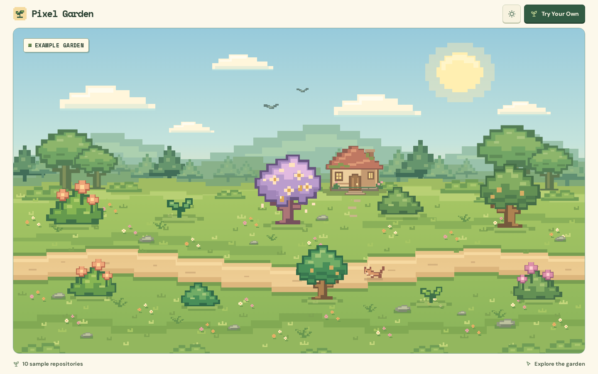

# Pixel Garden

Pixel Garden turns public GitHub repositories into an interactive pixel-art garden. The opening scene contains ten fictional projects and loads without using the GitHub API.



[Night garden](docs/screenshots/interactive-magic/night.png) · [Watering](docs/screenshots/interactive-magic/watering.png) · [Cottage surprise](docs/screenshots/interactive-magic/cottage.png) · [Legendary tree in an expanded garden](docs/screenshots/interactive-magic/legendary.png) · [Mobile night garden](docs/screenshots/interactive-magic/mobile.png)

Screenshots are from the production build in Chromium. The legendary tree appears in section two of a 50-repository test fixture.

## Explore a garden

- Select **Try Your Own** and enter a GitHub username or profile URL. Once loaded, the garden URL includes `?user=USERNAME` so you can reopen it directly.
- Switch between day and night with the header toggle. The whole garden changes as you scroll.
- Select a plant to see its repository, primary language, stars, and last push or update. With a keyboard, tab to a plant to show details and press Enter to move into the panel. Escape dismisses the panel. Choose **Water Plant** for a brief watering and bloom effect.
- Pet the cat, greet the birds, or knock on the cottage door. The gardener can reveal a project already loaded in your garden, including projects in later sections.
- The first ten plants fit in one scene. Larger profiles extend the garden to the right. Swipe, scroll horizontally, or use the section arrows. With focus on the landscape, use Left, Right, Home, or End.

## How repositories become plants

| GitHub data | Garden rule |
| --- | --- |
| Repository | One plant per retrieved public repository, including forks |
| Primary language | Foliage and blossom palette, with a stable fallback when language is unavailable |
| Repository ID | Stable fallback palette and sprite direction |
| Stars | Sprout (0–2), bush (3–14), flowering bush (15–59), large tree (60–249), legendary flowering tree (250+) |
| Push timestamp | A small gold accent for pushes within 14 days of the newest retrieved push |
| Ordering | Latest push first, then stars descending, case-insensitive name, and ID |

The same set of public records produces the same plants and slot order. Legendary trees have golden blossoms and briefly sparkle when inspected. Watering and animal reactions are temporary and leave repository data intact. The light setting starts at day on each page load, and cottage discoveries cycle through the loaded projects in reverse display order. Reduced-motion settings keep the visual feedback visible with static artwork.

The browser requests the first GitHub REST page of up to **100** public, owned repositories. The UI indicates when it reaches that cap. GitHub applies limits to unauthenticated requests. Successful lookups are cached in memory for five minutes, up to 20 profiles per tab. Pixel Garden has no server, credentials, analytics, or persistent application storage.

## Run locally

Use Node.js 22.12+ on the 22 LTS line, or Node.js 24.

```sh
npm ci
npm run dev
```

Open the local address shown by Vite under `/pixel-garden/`.

```sh
npm run format:check
npm run lint
npm run typecheck
npm test
npm run build
npx playwright install chromium
npm run test:e2e
```

On Linux, use `npx playwright install --with-deps chromium` if Chromium's system dependencies are missing. Browser tests serve the built `dist/` at the Pages subpath. They cover desktop and emulated mobile Chromium, all supported garden sizes, keyboard and touch, reduced motion, and axe checks. The live GitHub smoke test can be repeated by loading `https://github.com/octocat` through **Try Your Own**.

## GitHub Pages

The Vite build uses `/pixel-garden/`. The Pages workflow runs on manual dispatch from `main` and uploads only `dist/`. For an approved release, enable **Settings → Pages → Source → GitHub Actions**, then run **Deploy Pixel Garden to Pages** from `main`. Verify the URL emitted by the workflow and reload a profile URL with `?user=USERNAME`. The current release is available on [GitHub Pages](https://fatemeh-mohseni-ai.github.io/pixel-garden/).

## Project notes

- [Implementation plan and checklist](docs/IMPLEMENTATION_PLAN.md)
- [Project charter](docs/PROJECT_RULES.md)
- [Approved design brief](docs/DESIGN_BRIEF.md)
- The SVG artwork is original to this project. DM Sans and Space Mono are bundled under the SIL Open Font License with their [license texts](public/licenses/). The project code and artwork license is pending owner approval.
